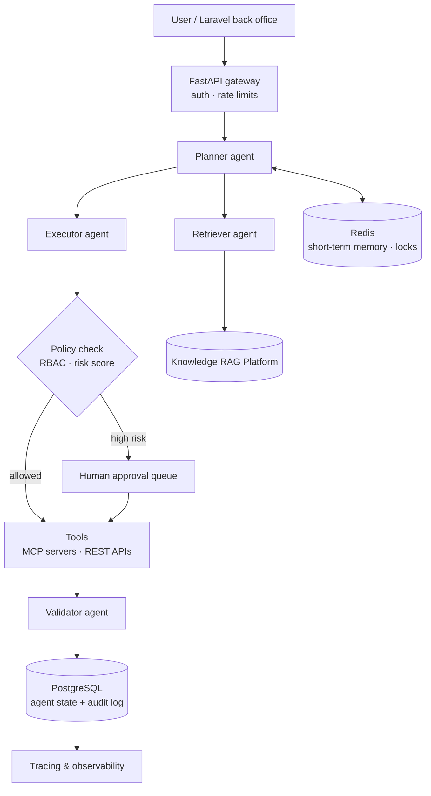

# Agentic Workflow Platform

**Multi-agent enterprise automation.** Specialized agents plan, retrieve, call business APIs, validate results and escalate to humans, with permission-aware tool execution and durable agent state.

> **Building in public.** The architecture and roadmap are published first. Code, benchmarks and results land milestone by milestone. Watch the repo to follow along.

## Problem

Complex business workflows (refund reviews, KYC checks, merchant onboarding, report preparation) force people to coordinate several systems by hand. Single-prompt chatbots can't do this safely: they lose state, call the wrong tool, or act without permission.

## Solution

A multi-agent architecture where each agent has one job:

| Agent | Responsibility |
| --- | --- |
| **Planner** | Breaks a request into steps and picks which agents run them |
| **Retriever** | Pulls context from documents and databases (connects to the [Knowledge RAG Platform](https://github.com/m-makhlafi/knowledge-rag-platform)) |
| **Executor** | Calls business APIs through function calling, only with tools the user is allowed to use |
| **Validator** | Checks outputs against schemas, business rules and policy before anything is committed |
| **Escalation** | Routes high-risk or low-confidence steps to a human for approval |

Key design points:

- **Permission-aware tool execution.** Every tool call is checked against the caller's role (RBAC), with scoped short-lived credentials.
- **Structured agent state.** Plans, steps, tool results and approvals are persisted in PostgreSQL, so runs can pause, resume and be audited.
- **Human-in-the-loop.** High-risk operations (money movement, data deletion) always require approval.
- **Tools exposed over MCP and REST.** Laravel back-office APIs become agent tools without rewriting them.

## Architecture

## Tech stack

| Layer | Technologies |
| --- | --- |
| Agents | Python, LLMs (Claude, OpenAI), function calling / tool use, structured outputs, LangGraph-style state machine |
| Tools | MCP servers, REST adapters for Laravel APIs, JSON-schema tool contracts |
| Serving | FastAPI, async workers |
| State & memory | PostgreSQL (state, audit), Redis (short-term memory, locks, queues) |
| Security | RBAC, scoped credentials, policy engine, full audit trail |
| Platform | Docker, Kubernetes |
| Observability | OpenTelemetry traces per agent step, cost and token tracking |

## Targets and how they are measured

| Target | Metric | Method | Result |
| --- | --- | --- | --- |
| Automate ~35% of targeted workflows end to end | % runs completed without manual work | Replay of a labeled workflow set | pending |
| Zero unapproved high-risk actions | Policy violations | Red-team scenarios + audit log review | pending |
| Correct tool selection | Tool-call accuracy | Scenario test suite | pending |

## Roadmap

- [x] Architecture and design document
- [ ] Tool contract format and MCP / REST adapters
- [ ] Planner + executor with persisted state
- [ ] Policy engine (RBAC, risk scoring) and human approval queue
- [ ] Retriever integration with Knowledge RAG Platform
- [ ] Validator agent and schema checks
- [ ] Tracing, cost tracking and evaluation suite
- [ ] Demo: refund-review workflow on a Laravel back office

---

Built by [Mohammed Al-Mekhlafi](https://github.com/m-makhlafi) · Full-Stack & AI Engineer
